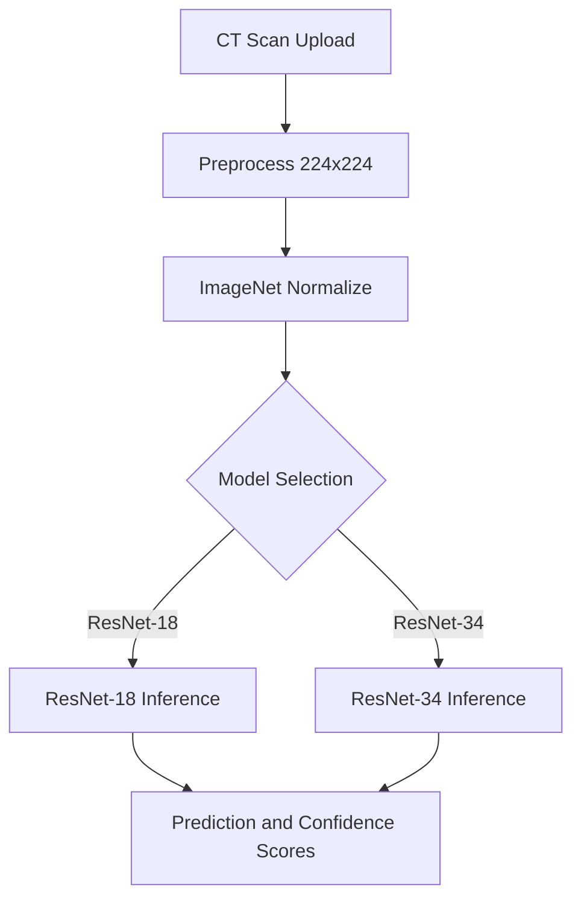

<div align="center">

# 🫁 Lung Cancer Detection from CT Scans Using CNN

**An interactive deep learning application for binary classification of lung CT scans**

[](https://huggingface.co/spaces/ameyac11/Lung-Cancer-Detection-from-CT-Scans-Using-CNN)
[](https://www.kaggle.com/models/ameyachopade/cnn-based-lung-cancer-detection-from-ct-scans/)
[](https://www.kaggle.com/datasets/ameyachopade/ct-scan-binary-classification-dataset/data)
[](LICENSE)

<br>

[](https://www.python.org/)
[](https://pytorch.org/)
[](https://gradio.app/)
[](#-models)

*Fine-tuned **ResNet-18** and **ResNet-34** CNNs · Real-time inference · Gradio web UI*

[](#-quick-start) · [](#-features) · [](#-project-structure) · [](#-dataset) · [](#-license)

</div>

---

## 📖 Overview

This project applies transfer learning with **ResNet** architectures to classify lung CT scan images as **Positive** (cancerous) or **Negative** (normal). A lightweight **Gradio** interface lets you upload scans, switch between models, and view confidence scores instantly - locally or on [](https://huggingface.co/spaces/ameyac11/Lung-Cancer-Detection-from-CT-Scans-Using-CNN).

> ⚠️ **Disclaimer:** This tool is intended for **research and educational purposes only**. It is **not** a medical device and must **not** be used for clinical diagnosis or treatment decisions.

---

## 🔄 How It Works



| Stage | Details |
|:------|:--------|
| **Input** | Lung CT scan image (JPG/PNG) |
| **Preprocessing** | Resize to 224×224, ImageNet normalization |
| **Models** | ResNet-18 & ResNet-34 (ImageNet pre-trained, fine-tuned) |
| **Output** | Class label + confidence scores for both classes |
| **Weights** | Stored as `.safetensors` in `Model/` |

---

## ✨ Features

| | Feature | Description |
|:---:|:---|:---|
| 🔀 | **Multi-Model Support** | Toggle between **ResNet-18** and **ResNet-34** to compare predictions side by side |
| ⚡ | **Real-Time Inference** | Fast CPU/GPU classification powered by **PyTorch** |
| 🖥️ | **Interactive UI** | Drag-and-drop uploads, model selector, and clear confidence bars via **Gradio** - predictions for **Positive** (Benign or Malignant) and **Negative** (Normal) |
| 📂 | **Pre-loaded Examples** | 10 sample CT scans in `examples/` for instant testing - no downloads required |
| 🔒 | **Safe Weights** | Model checkpoints loaded with **Safetensors** for secure, efficient deserialization |

---

## ⚙️ Training Environment

The models were trained and evaluated using cloud computing infrastructure.

### Hardware
- NVIDIA Tesla T4 ×2 GPUs
- 30 GB Total GPU Memory

### Software
- Python
- PyTorch
- TorchVision
- CUDA

### Training Configuration
- Transfer Learning with ImageNet-pretrained weights
- Binary Classification (Positive vs Negative)
- CT Scan Image Input
- GPU-Accelerated Training

The use of dual NVIDIA Tesla T4 GPUs enabled efficient training and experimentation with ResNet-based architectures for lung cancer classification from CT scan images.

---

## 🚀 Quick Start

### Prerequisites

- Python **3.8+**
- [](https://git-lfs.com/) *(required to pull model weights in `Model/`)*

### 1️⃣ Clone the repository

```bash
git clone https://github.com/ameyachopade/Lung-Cancer-Detection-from-CT-Scans-Using-CNN.git
cd Lung-Cancer-Detection-from-CT-Scans-Using-CNN
git lfs pull
```

### 2️⃣ Install dependencies

```bash
pip install -r requirements.txt
```

> 💡 **CPU-only PyTorch:** Uncomment the `--extra-index-url` line at the top of `requirements.txt` if you need the CPU-only wheel.

### 3️⃣ Launch the app

**Option A - Python script** *(recommended)*

```bash
python app.py
```

**Option B - Jupyter Notebook**

Open `app.ipynb` in Jupyter or VS Code, run all cells, and the Gradio server will start automatically.

🌐 Open your browser at **`http://127.0.0.1:7860`**

---

## 🧠 Models

| Model | Weights File | Architecture |
|:------|:-------------|:-------------|
| **ResNet-18** | `Model/resnet18_ct_v1.1.safetensors` | 18-layer residual network |
| **ResNet-34** | `Model/resnet34_ct_v1.safetensors` | 34-layer residual network *(default)* |

Both models use ImageNet pre-trained backbones with a replaced fully-connected layer for **2-class** binary classification.

📦 **Download separately:** [](https://www.kaggle.com/models/ameyachopade/cnn-based-lung-cancer-detection-from-ct-scans/)

---

## 📁 Project Structure

```
Lung-Cancer-Detection-from-CT-Scans-Using-CNN/
│
├── 📓 app.ipynb              # Gradio app (notebook version)
├── 🐍 app.py                 # Gradio app (script version)
├── 📋 requirements.txt       # Python dependencies
├── 📄 LICENSE                # Apache License 2.0
│
├── 🧠 Model/                 # Trained weights (Git LFS)
│   ├── resnet18_ct_v1.1.safetensors
│   └── resnet34_ct_v1.safetensors
│
└── 🖼️ examples/              # Sample CT scans for the demo UI
    ├── 1.jpg … 10.jpg
```

---

## 🔍 Dataset

This project uses a **derived binary-classification dataset** built from the [](https://www.kaggle.com/datasets/hamdallak/the-iqothnccd-lung-cancer-dataset).

| Original Class | Mapped To | Meaning |
|:---------------|:----------|:--------|
| Normal | **Negative** | No cancer detected |
| Benign + Malignant | **Positive** | Cancer indicators present |

The three-class source dataset was restructured into a **Positive / Negative** binary task to simplify lung cancer detection for deep learning and medical imaging research.

📦 **Access the derived dataset:** [](https://www.kaggle.com/datasets/ameyachopade/ct-scan-binary-classification-dataset/data)

> All credit for the original CT scan images belongs to the creators of the **IQ-OTH/NCCD Lung Cancer Dataset**.

---

## 🛠️ Tech Stack

<p align="center">
  
  
  
  
  
  
</p>

---

## 🌟 Support

If you find this project useful or interesting, please consider giving it a ⭐ on GitHub! Your support helps make the project more visible and encourages further development.

---

## 📄 License

This derived dataset and project code are distributed under the **[](LICENSE)**.

Original CT scan images were sourced from the **IQ-OTH/NCCD Lung Cancer Dataset**. Users must review and comply with the terms, licensing, and attribution requirements of the original dataset in addition to Apache 2.0.

---

<div align="center">

**Built with ❤️ for medical imaging research**

[](https://github.com/ameyachopade/Lung-Cancer-Detection-from-CT-Scans-Using-CNN) · [](https://github.com/ameyachopade/Lung-Cancer-Detection-from-CT-Scans-Using-CNN/issues) · [](https://huggingface.co/spaces/ameyac11/Lung-Cancer-Detection-from-CT-Scans-Using-CNN)

</div>
